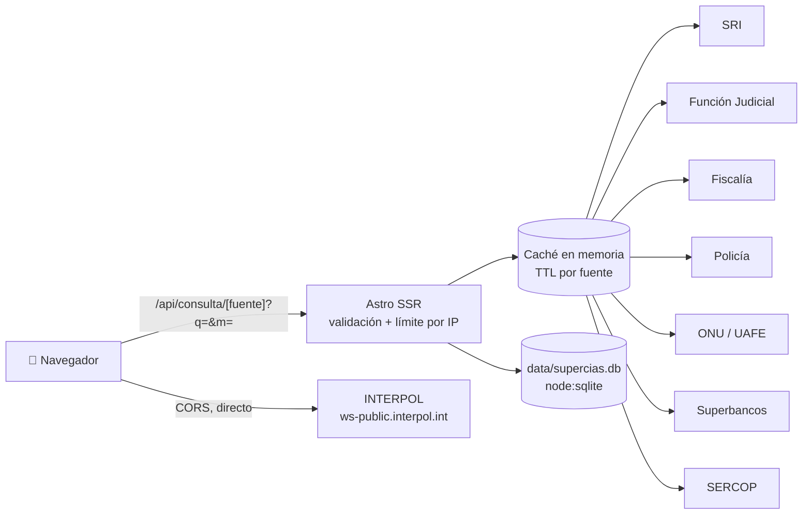

<div align="center">

# 🇪🇨 ConsultaEC

**Todo lo público de una persona o empresa del Ecuador, en una sola búsqueda.**

Escribe una **cédula**, un **RUC** o un **nombre** y ConsultaEC consulta en paralelo el SRI, la Función Judicial,
la Fiscalía, la Policía Nacional, INTERPOL, la UAFE, la Superintendencia de Bancos, la Supercias, el SERCOP
y el Ministerio del Interior, y te muestra cada resultado en su propia tarjeta a medida que llega.


</div>

---

## Índice

- [Qué hace](#qué-hace)
- [Fuentes](#fuentes)
- [Cómo funciona](#cómo-funciona)
- [Empezar en local](#empezar-en-local)
- [Desplegar en un VPS con Docker](#desplegar-en-un-vps-con-docker)
- [Variables de entorno](#variables-de-entorno)
- [Datos abiertos de la Supercias](#datos-abiertos-de-la-supercias)
- [Fuentes por convenio](#fuentes-por-convenio)
- [Seguridad](#seguridad)
- [Agregar una fuente](#agregar-una-fuente)
- [Estructura del proyecto](#estructura-del-proyecto)
- [Uso responsable](#uso-responsable)

---

## Qué hace

| Buscas… | Modo | Ejemplo |
|---|---|---|
| Una persona por cédula | 👤 Persona | `1710034065` |
| Una persona por nombre | 👤 Persona | `Willian Joffre Alcívar Bautista` |
| Una empresa por RUC | 🏢 Empresa | `1790010937001` |
| Una empresa por razón social | 🏢 Empresa | `NIXMA S.A.S.` |

Cada fuente responde por separado y su tarjeta queda en uno de estos estados:

| Estado | Significado |
|---|---|
| 🟢 **Con resultados** | La fuente devolvió datos |
| ⚪ **Sin registros** | La fuente respondió y no hay nada |
| 🟡 **Verificar en portal** | La fuente exige captcha o usuario: se ofrece el enlace oficial y el identificador para copiar |
| ⚫ **No aplica** | La fuente no admite ese tipo de búsqueda |
| 🔴 **Error** | La fuente no respondió (tiempo agotado, cambio de formato…) |

Cuando una lista no publica cédulas (Policía, INTERPOL, ONU, SB), la búsqueda es **por nombre** y cada
coincidencia se califica:

- **Exacta**: las mismas palabras, en cualquier orden.
- **Probable**: el nombre completo con una letra distinta (`WILLIAN` ≈ `WILLIAM`).
- **Parcial**: todas las palabras de un lado están en el otro (mínimo 2).

Si buscas por cédula, el nombre se toma del SRI (solo si la persona tiene RUC).

---

## Fuentes

| Tarjeta | Institución | Qué muestra | Acceso | Archivo |
|---|---|---|---|---|
| Registro Único de Contribuyentes | **SRI** | Estado del RUC, actividad, régimen, representantes legales, establecimientos, alertas de contribuyente fantasma | ✅ API pública | `sources/sri.ts` |
| Causas judiciales | **Función Judicial** | Procesos como actor o demandado | ✅ API E-SATJE · 🟡 enlace si pide captcha | `sources/judicial.ts` |
| Noticias del delito | **Fiscalía** | Noticias del delito asociadas | ✅ Endpoint del formulario público | `sources/fiscalia.ts` |
| Los Más Buscados | **Policía Nacional** | Ficha, **foto**, alias, delito y grupo en 4 listas (ejercicio público, violencia de género, corrupción, fuera del país) | ✅ API WordPress pública | `sources/policia.ts` |
| Notificaciones rojas | **INTERPOL** | **Foto**, nacimiento, nacionalidad, cargos y país solicitante | ✅ API pública **desde el navegador** | `sources/policia.ts` + `index.astro` |
| Listas restrictivas (ONU) | **UAFE** | Coincidencias en la Lista Consolidada de sanciones del Consejo de Seguridad | ✅ XML oficial | `sources/uafe.ts` |
| Entidades no autorizadas y catastro | **Superintendencia de Bancos** | ~590 entidades detectadas captando o prestando sin autorización (2017–2026) y bancos autorizados | ✅ API WordPress pública | `sources/superbancos.ts` |
| Directorio y estados financieros | **Supercias** | Datos de la compañía, ingresos, activos, patrimonio, utilidad, empleados y ranking por año | ✅ Datos abiertos importados | `sources/directorio.ts` |
| Documentos societarios | **Supercias** | Generales, jurídicos y económicos | 🔐 Convenio · 🟡 enlace (reCAPTCHA) | `sources/supercias.ts` |
| Contratación pública | **SERCOP** | Contratos como proveedor y como entidad contratante (5 años) + ficha OCDS | ✅ API de datos abiertos | `sources/sercop.ts` |
| Antecedentes penales | **Ministerio del Interior** | Certificado oficial | 🔐 Convenio · 🟡 enlace + lectura local del PDF | `sources/antecedentes.ts` |

> [!NOTE]
> **Lo que no se puede consultar** y por qué:
> - **UAFE**: los reportes de operaciones sospechosas son **reservados por ley**. No existe consulta pública de "sospechoso sí/no". El código de registro y el certificado de cumplimiento solo se ven con usuario en SISLAFT.
> - **Superintendencia de Bancos**: el registro crediticio y el certificado de titulares de cuenta corriente (cheques protestados) solo los obtiene el **propio titular** con su usuario.
> - **INTERPOL**: solo se publican las notificaciones rojas que el país solicitante autoriza.

---

## Cómo funciona



1. El navegador valida la entrada y llama a `/api/consulta/<fuente>` **una vez por fuente, en paralelo**.
2. El servidor vuelve a validar, aplica el límite por IP, consulta la fuente oficial (con caché) y devuelve un `SourceResult` normalizado.
3. Cada tarjeta se pinta en cuanto llega su respuesta. Todo texto externo se inserta con `textContent`.
4. **INTERPOL** bloquea peticiones desde servidores, pero su API admite CORS: el servidor solo resuelve el nombre y la búsqueda la hace el navegador del usuario, igual que el buscador oficial.

---

## Empezar en local

Requisitos: **Node ≥ 22.23** (recomendado 24 LTS; usa `node:sqlite`).

```sh
npm install
npm run dev            # http://localhost:4321
```

Con el CLI de Astro el servidor de desarrollo también puede correr en segundo plano:

```sh
npx astro dev --background     # astro dev status | logs | stop
```

Producción sin Docker:

```sh
npm run build
HOST=0.0.0.0 PORT=4321 node dist/server/entry.mjs
```

Opcional: importa los datos abiertos de la Supercias ([ver abajo](#datos-abiertos-de-la-supercias)).

---

## Desplegar en un VPS con Docker

El repositorio trae todo lo necesario:

| Archivo | Para qué |
|---|---|
| `Dockerfile` | Imagen multi-etapa en `node:24-bookworm-slim`, usuario sin privilegios, healthcheck |
| `docker-compose.yml` | App + **Caddy** (HTTPS automático con Let's Encrypt). Solo Caddy expone puertos |
| `Caddyfile` | Proxy inverso, compresión y cabeceras de seguridad |
| `.dockerignore` | Deja fuera `data/`, `logs/`, `.env` y `node_modules` |

### Paso a paso

**1. Prepara el VPS** (Ubuntu/Debian) y apunta tu dominio (registro **A**) a la IP del servidor.

```sh
curl -fsSL https://get.docker.com | sh
sudo usermod -aG docker $USER   # vuelve a iniciar sesión
```

**2. Sube el proyecto y configura el entorno.**

```sh
git clone <tu-repo> consultec && cd consultec
cp .env.example .env
nano .env                        # DOMAIN=consulta.tudominio.com
mkdir -p data logs && sudo chown -R 1000:1000 data logs
```

**3. Levanta todo.**

```sh
docker compose up -d --build
docker compose ps                # app: healthy · caddy: running
docker compose logs -f app
```

Abre `https://consulta.tudominio.com`. Caddy obtiene y renueva el certificado solo.

**4. (Opcional) Importa los datos de la Supercias** dentro del contenedor:

```sh
docker compose run --rm app node scripts/import-supercias.mjs
docker compose restart app
```

Para refrescarlos cada mes, con `crontab -e`:

```cron
0 4 1 * * cd /ruta/consultec && docker compose run --rm app node scripts/import-supercias.mjs && docker compose restart app
```

**Actualizar a una versión nueva:**

```sh
git pull && docker compose up -d --build
```

> [!IMPORTANT]
> El servicio `app` usa `expose` (no `ports`): **no publiques el puerto 4321**. Con `TRUST_PROXY=1`
> la app confía en `X-Forwarded-For` para el límite por IP; si el puerto quedara abierto, ese encabezado
> se podría falsificar.

¿Ya tienes Nginx u otro proxy? Quita el servicio `caddy` del compose, publica `127.0.0.1:4321:4321`
en `app` y deja `TRUST_PROXY=1` solo si el proxy sobrescribe `X-Forwarded-For`.

---

## Variables de entorno

Copia `.env.example` a `.env`. Todas son opcionales salvo `DOMAIN` para Docker.

| Variable | Por defecto | Descripción |
|---|---|---|
| `DOMAIN` | — | Dominio público que Caddy sirve con HTTPS |
| `TRUST_PROXY` | `0` (`1` en compose) | Toma la IP real de `X-Forwarded-For` (solo detrás de un proxy) |
| `RATE_LIMIT_PER_MIN` | `40` | Peticiones por minuto y por IP. Cada búsqueda de persona usa ~9 |
| `SUPERCIAS_DB` | `data/supercias.db` | Ruta de la base de datos abierta de la Supercias |
| `HOST` / `PORT` | `0.0.0.0` / `4321` | Dirección del servidor Node |
| `MDI_API_URL`, `MDI_API_KEY`, `MDI_MOTIVO`… | — | Convenio de antecedentes penales ([ver abajo](#fuentes-por-convenio)) |
| `SUPERCIAS_API_URL`, `SUPERCIAS_API_KEY`… | — | Convenio de documentos societarios |
| `MDI_AUDIT_LOG`, `SUPERCIAS_AUDIT_LOG` | `logs/…` | Bitácora de consultas por convenio |

---

## Datos abiertos de la Supercias

```sh
npm run data:supercias                   # descarga ~430 MB e importa a data/supercias.db (~140 MB)
npm run data:supercias -- --years 10     # más años de estados financieros (por defecto 6)
npm run data:supercias -- --no-download  # reimporta con los CSV ya descargados
```

Fuente: los CSV públicos del [Ranking Empresarial](https://appscvsmovil.supercias.gob.ec/ranking/reporte.html)
(`bi_compania`, `bi_ranking`, `bi_ciiu`, `bi_segmento`). Sin la base, la tarjeta explica cómo importarla.

---

## Fuentes por convenio

Algunos portales están protegidos con captcha. **ConsultaEC no evade captchas**: esas fuentes solo se
automatizan con el servicio web que la institución entrega por convenio. Sin convenio, la tarjeta muestra el
portal oficial y un botón para copiar el identificador.

<details>
<summary><b>Antecedentes penales (Ministerio del Interior / DINARDAP)</b></summary>

1. Completa `MDI_API_URL`, `MDI_API_KEY` y `MDI_MOTIVO` en `.env`.
2. Ajusta `buildRequest()` y `parseResponse()` en `src/lib/sources/antecedentes.ts` según la especificación oficial.
3. Reinicia. La tarjeta pasa a "Automático" en la portada.

Cada consulta queda en `MDI_AUDIT_LOG` (fecha, cédula, motivo, IP y código HTTP), como exigen los convenios.
Sin convenio, el usuario descarga el PDF en el portal y la app lo **lee en el navegador** (no se sube a ningún servidor).

</details>

<details>
<summary><b>Documentos societarios (Supercias)</b></summary>

1. Completa `SUPERCIAS_API_URL` y `SUPERCIAS_API_KEY` en `.env`.
2. Ajusta `buildRequest()` y `parseResponse()` en `src/lib/sources/supercias.ts`.
3. Reinicia. Auditoría opcional con `SUPERCIAS_AUDIT_LOG`; respuestas en caché 6 h.

</details>

Credenciales y bitácora comparten el helper `src/lib/convenio.ts`.

---

## Seguridad

**Validación de entrada** (`src/lib/validate.ts`), idéntica en navegador y servidor:

| Entrada | Reglas |
|---|---|
| Cédula | 10 dígitos, provincia válida, dígito verificador módulo 10 |
| RUC | 13 dígitos, estructura de persona natural, sociedad pública o privada |
| Nombre (persona) | Solo letras latinas (con tildes y ñ), espacios, `'` y `-` · 2 a 6 palabras · 5 a 80 caracteres · máx. 25 por palabra |
| Razón social | Letras latinas, dígitos, espacios y `. , & - ' ( ) /` · máx. 15 palabras y 120 caracteres |
| Cualquier entrada | Máx. 150 caracteres · sin caracteres invisibles o de control · sin un mismo carácter repetido 5+ veces |

**Otras medidas:**

- Límite por IP compartido entre `/api/consulta/*` y `/contrato/*`, con IP real tras el proxy (`TRUST_PROXY`).
- Caché en memoria con tope duro de entradas.
- Todo dato externo se pinta con `textContent`. Los enlaces solo aceptan `http(s)` o rutas internas y las fotos solo `https`.
- SQL siempre con parámetros (`node:sqlite`).
- Contenedor sin root, sistema de archivos de solo lectura, `no-new-privileges`, y secretos solo en `.env`.
- Cabeceras HSTS, `nosniff`, `X-Frame-Options` y `Referrer-Policy` desde Caddy.

---

## Agregar una fuente

1. Crea `src/lib/sources/mi-fuente.ts` que exporte un `Source`:

   ```ts
   export const miFuente: Source = {
     id: 'mifuente',
     name: 'Nombre de la tarjeta',
     institution: 'Institución',
     officialUrl: 'https://…',
     supports: ['cedula', 'ruc', 'nombre'],
     async run(q) {
       // q.kind, q.value (limpio), q.mode
       return { status: 'ok', summary: '…', fields: [], tables: [] };
     },
   };
   ```

2. Regístrala en `SOURCES` y en el `ORDER` del modo que corresponda (`src/lib/sources/index.ts`).
3. Usa `fetchT()` (timeout) y `cached()` (TTL) de `src/lib/http.ts`, y `matchLevel()` / `matchEntity()` de `src/lib/match.ts` para comparar nombres.

---

## Estructura del proyecto

```text
consultEc/
├── src/
│   ├── pages/
│   │   ├── index.astro               # UI: búsqueda, tarjetas, INTERPOL en el navegador, lector de PDF
│   │   ├── api/consulta/[source].ts  # Endpoint por fuente
│   │   └── contrato/[ocid].astro     # Ficha de un proceso del SERCOP
│   ├── lib/
│   │   ├── sources/                  # Una fuente por archivo + index.ts (registro y orden)
│   │   ├── validate.ts               # Cédula, RUC, nombres y razón social
│   │   ├── match.ts                  # Coincidencia de nombres (personas y entidades)
│   │   ├── ratelimit.ts              # Límite por IP + IP real tras proxy
│   │   ├── http.ts                   # fetch con timeout, caché, parser de tablas HTML
│   │   ├── convenio.ts               # Credenciales y bitácora de convenios
│   │   └── types.ts                  # Source, SourceResult, Table, Cell…
│   ├── layouts/  styles/
├── scripts/import-supercias.mjs      # Importador de datos abiertos
├── Dockerfile · docker-compose.yml · Caddyfile · .dockerignore
└── .env.example
```

---

## Uso responsable

> [!WARNING]
> ConsultaEC reúne **datos personales** protegidos por la **Ley Orgánica de Protección de Datos Personales (LOPDP)**.
> Los resultados son **referenciales y sin validez oficial**: para trámites usa siempre el certificado de la institución.

- **Una coincidencia de nombre no confirma identidad.** Compara la edad, la foto y los documentos.
- **Figurar en una noticia del delito o en una causa no implica culpabilidad**: puede ser como denunciante, víctima o testigo (presunción de inocencia, Constitución art. 76.2). Usar esta información para discriminar se sanciona (COIP art. 176).
- **Las listas de los más buscados pueden estar desactualizadas**: pueden incluir personas ya capturadas.
- **INTERPOL** limita el uso de sus notificaciones a informar al público y recibir información: nada de fines comerciales.
- Por **Decreto Ejecutivo 1166**, nadie puede exigir el certificado de antecedentes penales como requisito.

<div align="center">

Hecho en Ecuador con datos públicos · Si tienes información sobre una persona buscada, llama al **1800 DELITO (335486)**

</div>
